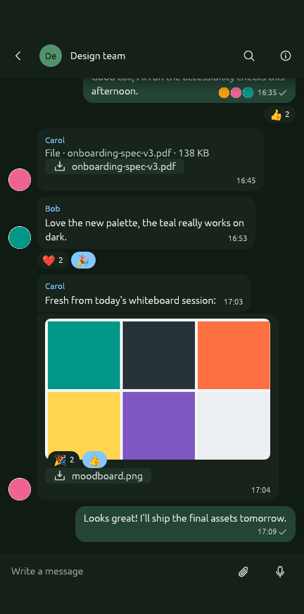

# Gnobbi

Open source [Matrix](https://matrix.org/) client for desktop and mobile, written in Rust with an [egui](https://github.com/emilk/egui) (eframe) interface. Gnobbi talks directly to your homeserver, with no gateways or middle services: account, messages and keys stay between the client and the server you chose.

**[TestFlight beta (iPhone and iPad)](https://testflight.apple.com/join/ZGYennpy) · Google Play: coming soon · [Desktop releases](https://github.com/meska/gnobbi/releases)**

<table>
  <tr>
    <td width="66%"></td>
    <td width="34%"></td>
  </tr>
  <tr>
    <td></td>
    <td></td>
  </tr>
</table>

Main features:

- sign in with ID and password on your own homeserver (Synapse and Tuwunel are the reference servers);
- end-to-end encryption through the official [Matrix Rust SDK](https://github.com/matrix-org/matrix-rust-sdk);
- native Wayland (and X11) interface on Linux; builds for macOS, Windows, iOS and Android.

**Status: beta.** The interface is constantly evolving.

## Try it

Choose a beta or desktop release from the links above, or build from source (see below).

## Translations

The interface can be translated with plain text files: see [TRANSLATING.md](TRANSLATING.md).

## Structure

- `crates/matrix-domain`: models and design tokens, no SDK and no UI toolkit;
- `crates/matrix-engine`: adapter for the Matrix Rust SDK (with the `sdk` feature);
- `crates/matrix-desktop`: the client. The library is the toolkit-free application layer (state, preferences, projections); the `gnobbi` binary (`src/bin/gnobbi`) is the app itself — the same binary builds the desktop app (egui interface) and the iOS and Android apps;
- `vendor/`: local copies of patched dependencies (Matrix Rust SDK, egui/eframe, winit), wired through `[patch.crates-io]` in the root `Cargo.toml`;
- `packaging/`: AppImage, macOS package, Windows zip, iOS and Android bundles, icons.

## Building

A recent Rust toolchain is required (edition 2024; developed with rustc 1.99). From the repository root:

```sh
cargo build --locked -p matrix-desktop --features linux-vault
```

The binary is `target/debug/gnobbi`. On macOS the feature is `mac-vault`, on Windows `windows-vault` (system keychain). Plain `cargo build --locked` builds the base libraries (`matrix-domain`, `matrix-engine`).

On Linux the build needs `pkg-config` and system headers; the reference environment (Debian 12) has `build-essential pkg-config libssl-dev libwayland-dev libxkbcommon-dev libasound2-dev libudev-dev libvulkan-dev libdbus-1-dev` installed. At runtime the GPU/Vulkan/Wayland libraries come from the host.

### Tests

```sh
cargo test --locked -p matrix-domain
cargo test --locked -p matrix-desktop
```

Tests that touch the network and a homeserver use disposable fixtures; the unit tests run without a server.

## First run and sign-in

The first sign-in asks for homeserver, Matrix ID and password; the key protecting the local store is kept in the system keychain (Secret Service on Linux), with no passphrase to make up. After signing in, an optional step lets you enter your existing Matrix recovery key (not the local passphrase) to recover previous encrypted history from the backup; not every old message is guaranteed to be in the backup. A wrong key or a network error leaves the backup untouched and you can retry; you can always continue without recovery. An account without a Matrix secret store finds out when it tries a key: at that point Gnobbi offers "Create recovery key", which generates a key and the encryption-key backup, shows the key once (explicit copy, then a confirmation that you saved it) and only then continues; if creation fails, the server is left as it was and you can retry. Gnobbi creates recovery only when both the secret store and the backup are missing: an account with a backup but no store (or the other way around) is refused without changes, and existing keys or backups are never replaced. The backup protects encrypted messages exchanged by this device after creation: previous history, never saved in a backup, does not become readable and is not promised. If the keychain is unavailable or locked, Gnobbi says so and does not touch the profile. Building without `linux-vault` keeps the old module with a local passphrase.

Startup: `target/debug/gnobbi` (or `cargo run --locked -p matrix-desktop --features linux-vault`) opens the default profile in the app's data folder; further profiles are added from the app's account panel. `gnobbi --signin <absolute-profile-folder> [--ca-file <absolute-pem>]` opens an isolated profile, for example to try a test homeserver.

## Command-line accounts

For login, logout, session verification and recovery-key management, also in scripts and CI, see the [account CLI guide](ACCOUNT_CLI.md).

For what is planned, see the [roadmap](ROADMAP.md).

## Contributing

See [CONTRIBUTING](CONTRIBUTING.md). To report vulnerabilities: [SECURITY](SECURITY.md).

## License

Copyright (c) 2026 Marco Mescalchin. Dual-licensed under [MIT](LICENSE-MIT) or [Apache-2.0](LICENSE-APACHE), at your option.

Third-party dependencies have their own licenses: see [THIRD_PARTY_NOTICES](THIRD_PARTY_NOTICES.md).
