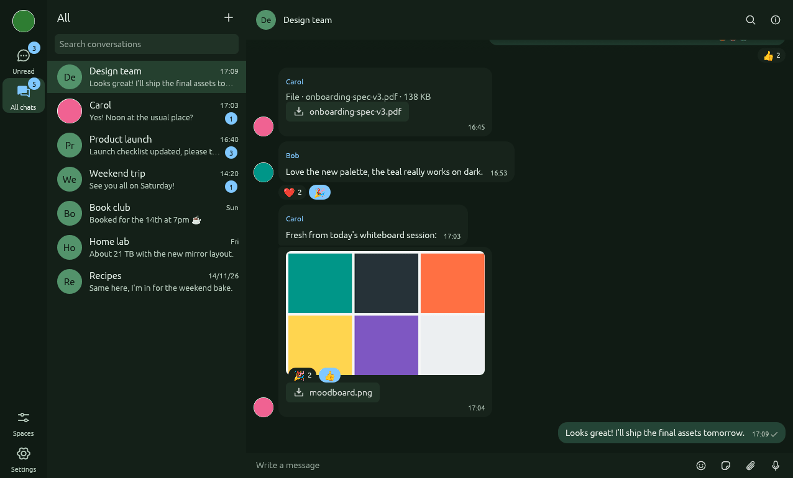
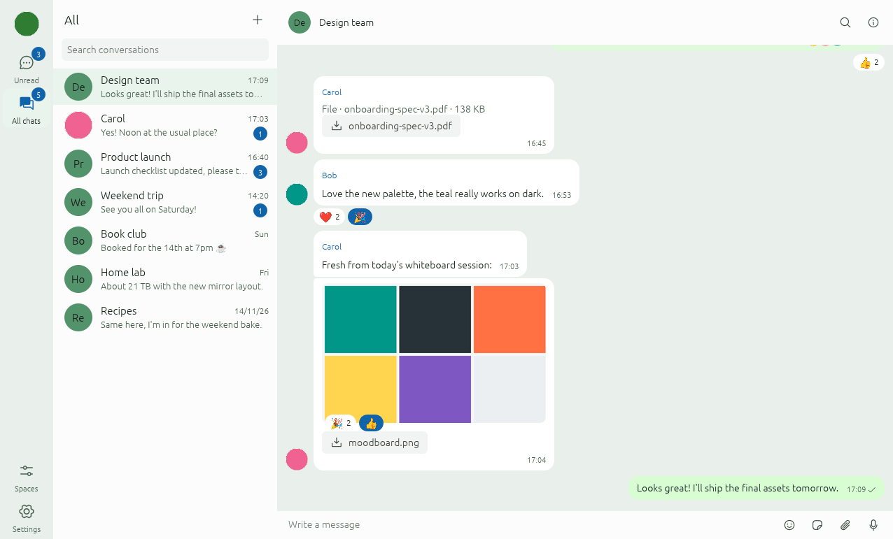
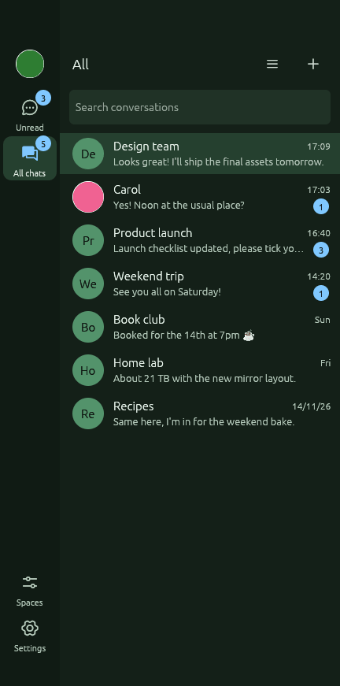

# Gnobbi

Client desktop [Matrix](https://matrix.org/) open source, scritto in Rust con interfaccia [egui](https://github.com/emilk/egui) (eframe). Gnobbi si collega direttamente al proprio homeserver, senza gateway o servizi intermedi: account, messaggi e chiavi restano tra il client e il server scelto.

<table>
  <tr>
    <td width="66%"></td>
    <td width="34%"></td>
  </tr>
  <tr>
    <td></td>
    <td></td>
  </tr>
</table>

Caratteristiche principali:

- accesso con ID e password al proprio homeserver (Synapse e Tuwunel sono i server di riferimento);
- crittografia end-to-end tramite il [Matrix Rust SDK](https://github.com/matrix-org/matrix-rust-sdk) ufficiale;
- interfaccia nativa Wayland (e X11) su Linux; build per macOS e Windows.

**Stato: sviluppo iniziale.** Non ci sono ancora release o binari pubblici: il progetto si compila dai sorgenti e l'interfaccia è in continua evoluzione.

## Traduzioni

L'interfaccia è traducibile con semplici file di testo: vedi [TRANSLATING.md](TRANSLATING.md) (in inglese).

## Struttura

- `crates/matrix-domain`: modelli e design token, senza SDK né toolkit grafico;
- `crates/matrix-engine`: adattatore del Matrix Rust SDK (con la feature `sdk`);
- `crates/matrix-desktop`: il client desktop. La libreria è lo strato applicativo senza toolkit (stato, preferenze, proiezioni), il binario `gnobbi` (`src/bin/gnobbi`) è l'app, con interfaccia egui;
- `vendor/`: copie locali di dipendenze patchate (Matrix Rust SDK, egui/eframe, winit), collegate da `[patch.crates-io]` nel `Cargo.toml` di radice;
- `packaging/`: AppImage, pacchetto macOS, zip Windows, icone.

## Compilazione

Serve una toolchain Rust recente (edizione 2024; sviluppato con rustc 1.99). Dalla radice del repository:

```sh
cargo build --locked -p matrix-desktop --features linux-vault
```

Il binario è `target/debug/gnobbi`. Su macOS la feature è `mac-vault`, su Windows `windows-vault` (portachiavi di sistema). Con il solo `cargo build --locked` si compilano le librerie di base (`matrix-domain`, `matrix-engine`).

Su Linux la build richiede `pkg-config` e gli header di sistema; l'ambiente di riferimento (Debian 12) ha installati `build-essential pkg-config libssl-dev libwayland-dev libxkbcommon-dev libasound2-dev libudev-dev libvulkan-dev libdbus-1-dev`. A runtime le librerie GPU/Vulkan/Wayland arrivano dall'host.

### Test

```sh
cargo test --locked -p matrix-domain
cargo test --locked -p matrix-desktop
```

I test che toccano rete e homeserver usano fixture usa e getta; le unit test girano senza server.

## Avvio e accesso

Il primo accesso chiede homeserver, ID Matrix e password; la chiave che protegge l'archivio locale è custodita nel portachiavi di sistema (Secret Service su Linux), senza frase da inventare. Dopo l'accesso un passo facoltativo permette di inserire la chiave di recupero Matrix esistente (non la frase locale) per recuperare dal backup la cronologia cifrata precedente; non tutti i vecchi messaggi sono garantiti nel backup. Una chiave errata o un errore di rete lasciano il backup intatto e si può riprovare; si può sempre proseguire senza recupero. Un account senza archivio segreto Matrix lo scopre quando si prova una chiave: a quel punto Gnobbi offre «Crea chiave di recupero», che genera una chiave e il backup delle chiavi di cifratura, mostra la chiave una sola volta (copia esplicita, poi conferma di averla salvata) e solo allora prosegue; se la creazione fallisce, il server resta com'era e si può riprovare. Gnobbi crea il recupero soltanto quando mancano sia l'archivio segreto sia il backup: un account con backup ma senza archivio (o l'inverso) viene rifiutato senza modifiche, e chiavi o backup esistenti non vengono mai sostituiti. Il backup protegge i messaggi cifrati scambiati da questo dispositivo dopo la creazione: la cronologia precedente, mai salvata in un backup, non diventa leggibile e non è promessa. Se il portachiavi non è disponibile o è bloccato, Gnobbi lo dice e non modifica il profilo. Compilando senza `linux-vault` resta il vecchio modulo con frase locale.

Avvio: `target/debug/gnobbi` (o `cargo run --locked -p matrix-desktop --features linux-vault`) apre il profilo predefinito nella cartella dati dell'app; i profili successivi si aggiungono dal pannello account dell'app. `gnobbi --signin <cartella-profilo-assoluta> [--ca-file <pem-assoluto>]` apre un profilo isolato, ad esempio per provare un homeserver di test.

## Account da riga di comando

Per login, logout, verifica della sessione e gestione della chiave di recupero, anche in script e CI, vedi la [guida alla CLI account](ACCOUNT_CLI.md).

Per cosa è in programma vedi la [roadmap](ROADMAP.md) (in inglese).

## Come contribuire

Vedi [CONTRIBUTING](CONTRIBUTING.md). Per segnalare vulnerabilità: [SECURITY](SECURITY.md).

## Licenza

Copyright (c) 2026 Marco Mescalchin. Distribuito con doppia licenza [MIT](LICENSE-MIT) oppure [Apache-2.0](LICENSE-APACHE), a scelta dell'utente.

Le dipendenze di terze parti hanno licenze proprie: vedi [THIRD_PARTY_NOTICES](THIRD_PARTY_NOTICES.md).
